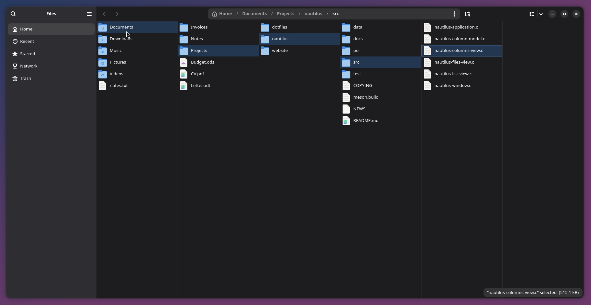
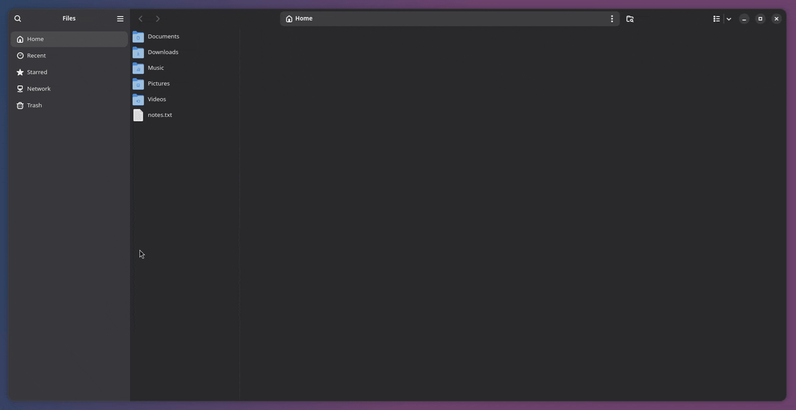

# Nautilus Miller columns

A Miller-columns ("column view") mode for GNOME Files (Nautilus), as a patch.

Selecting a folder opens its contents in a new column to the right. The folders
on the open path stay highlighted, and the path bar follows the deepest open
folder.





## Apply

Against upstream Nautilus, commit `141cc0555` ("previewer: Add rename and trash DBus subscriptions"):

```sh
git clone https://gitlab.gnome.org/GNOME/nautilus.git
cd nautilus
git checkout 141cc0555
git apply ../nautilus-miller-columns.patch
meson setup _build && ninja -C _build
```

## Use

- The view switcher button cycles list → grid → columns.
- `Ctrl+3` switches to the columns view.
- Left/Right move between columns.
